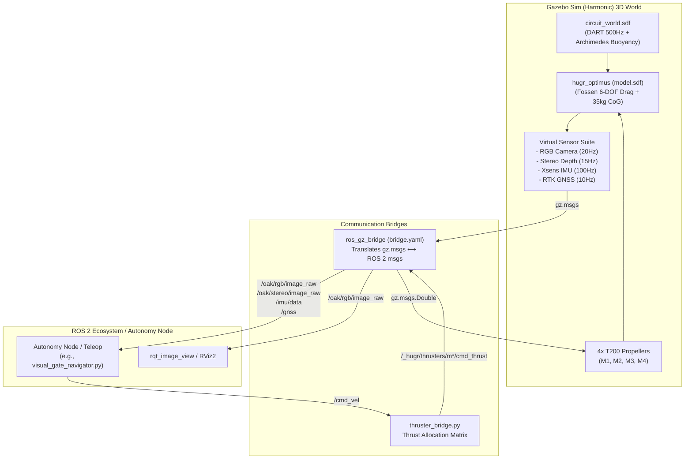

# SeaBotics Hugr Optimus - Gazebo Sim (Harmonic) Maritime Digital Twin

[](https://docs.ros.org/en/jazzy/)
[](https://gazebosim.org/docs/harmonic/)
[-E95420.svg?style=flat-square)](https://ubuntu.com/)
[](LICENSE)

High-fidelity 3D maritime simulation package for the **SeaBotics Hugr Optimus** Autonomous Surface Vehicle (ASV). Designed with strict **Sim2Real Hardware Parity** to run identical autonomy algorithms seamlessly in simulation and on the real physical boat.

Compatible with **Native Linux (Ubuntu 24.04)** and **Windows 11 (WSL2 with WSLg GPU Acceleration)**.

---

## 📑 Table of Contents

- [Package Structure & File-by-File Breakdown](#-package-structure--file-by-file-breakdown)
- [System Architecture & Data Flow](#-system-architecture--data-flow)
- [Prerequisites & System Setup](#-prerequisites--system-setup)
- [How to Launch the Simulator](#-how-to-launch-the-simulator)
  - [Linux (Ubuntu 24.04 Native)](#1-linux-ubuntu-2404-native)
  - [Windows 11 (WSL2 / WSLg)](#2-windows-11-wsl2--wslg)
  - [Headless Mode (Server / CI)](#3-headless-mode-server--ci)
- [Sim2Real Sensor & Actuator Topics](#-sim2real-sensor--actuator-topics)
- [Naval Architecture & Hydrodynamics Physics](#-naval-architecture--hydrodynamics-physics)
- [Standalone GitHub Deployment](#-standalone-github-deployment)

---

## 📦 Package Structure & File-by-File Breakdown

Everything required to run the simulation is self-contained within this folder:

```text
hugr_gazebo/
├── CMakeLists.txt                 # ROS 2 CMake build definition & asset install rules
├── package.xml                    # Package dependencies and metadata
├── README.md                      # Comprehensive documentation & architecture guide
├── run_gazebo.sh                  # 1-Click launcher for Linux / WSL (with auto-clean & trap)
├── run_gazebo.bat                 # 1-Click launcher for Windows 11 (invokes WSL2)
│
├── config/
│   └── bridge.yaml                # Bidirectional Gazebo Sim ⟷ ROS 2 topic translation
│
├── launch/
│   └── sim.launch.py              # Unified ROS 2 launch file for Gazebo, Bridge, and Thrusters
│
├── scripts/
│   └── thruster_bridge.py         # Thrust allocation mixer (/cmd_vel ➔ 4 T200 thrusters in Newtons)
│
├── worlds/
│   ├── circuit_world.sdf          # 3D Ocean world, DART physics, Archimedes buoyancy & buoy course
│   └── README.md                  # World coordinate documentation & buoy positions
│
└── models/
    └── hugr_optimus/
        ├── model.config           # Gazebo model identification manifest
        ├── model.sdf              # Complete ASV physics, CAD visual, buoyancy boxes, Fossen drag & sensors
        ├── README.md              # Vessel model design specifications
        └── meshes/
            └── frame.stl          # High-resolution 3D CAD mesh from OnShape assembly
```

### Detailed Breakdown of Every File

| File | Purpose & Responsibilities |
| :--- | :--- |
| **[`CMakeLists.txt`](CMakeLists.txt)** | Standard `ament_cmake` build script. Installs `launch`, `worlds`, `models`, and `config` folders into the package share directory and registers `scripts/thruster_bridge.py` as an executable node in `lib/hugr_gazebo`. |
| **[`package.xml`](package.xml)** | ROS 2 package manifest specifying dependencies: `ros_gz_sim`, `ros_gz_bridge`, `geometry_msgs`, `sensor_msgs`, `nav_msgs`, and `std_msgs`. |
| **[`run_gazebo.sh`](run_gazebo.sh)** | Autonomous shell launcher for Linux/WSL. Automatically resolves workspace paths, compiles with `colcon` if unbuilt, links WSLg X11 display sockets, installs a signal trap (`EXIT`, `INT`, `TERM`) to kill background zombie processes, and launches the full simulation. |
| **[`run_gazebo.bat`](run_gazebo.bat)** | Windows 11 batch launcher. Converts the local directory path to WSL format via `wslpath` and triggers `run_gazebo.sh` in Ubuntu with a single click. |
| **[`config/bridge.yaml`](config/bridge.yaml)** | Configuration for `ros_gz_bridge:parameter_bridge`. Maps native Google Protocol Buffers (`gz.msgs`) to ROS 2 standard messages (`sensor_msgs`, `nav_msgs`, `geometry_msgs`) for images, depth maps, IMU, GPS, and thrusters. |
| **[`launch/sim.launch.py`](launch/sim.launch.py)** | Master Python launch file. Configures `GZ_SIM_RESOURCE_PATH`, launches Gazebo Sim Harmonic (GUI or headless), spawns `ros_gz_bridge`, and starts the `thruster_bridge.py` node. |
| **[`scripts/thruster_bridge.py`](scripts/thruster_bridge.py)** | ROS 2 Python node implementing the **Thrust Allocation Matrix**. Listens to `/cmd_vel` ($u$ linear speed, $\omega$ yaw rate) or `/motor_pwms` and commands the 4 BlueRobotics T200 thrusters with calibrated forces in Newtons. |
| **[`worlds/circuit_world.sdf`](worlds/circuit_world.sdf)** | Defines the ocean plane ($200\text{ m} \times 200\text{ m}$), DART physics ($500\text{ Hz}$, step $0.002\text{ s}$), Archimedes fluid buoyancy plugin ($\rho_{\text{water}} = 1000\text{ kg/m}^3$), sunlight, and the competition course (Gates 1–4, obstacle buoy, and yellow turnaround pillar). |
| **[`models/hugr_optimus/model.sdf`](models/hugr_optimus/model.sdf)** | The complete ASV digital twin: 35 kg mass, Center of Gravity at $Z = -0.30\text{ m}$ for self-righting stability, OnShape CAD mesh, 9 analytical buoyancy boxes, 6-DOF Fossen damping, 4 T200 thrusters, OAK-D RGB-D, Xsens IMU, and RTK GNSS. |
| **[`models/hugr_optimus/model.config`](models/hugr_optimus/model.config)** | Gazebo metadata file defining model name, author, version, and pointing to `model.sdf`. |
| **[`models/hugr_optimus/meshes/frame.stl`](models/hugr_optimus/meshes/frame.stl)** | Authentic 3D surface mesh exported from the SeaBotics OnShape engineering assembly. |

---

## 🔄 System Architecture & Data Flow



---

## 🛠 Prerequisites & System Setup

### Linux (Native Ubuntu 24.04)
1. Install **ROS 2 Jazzy Jalisco**:
   ```bash
   sudo apt update && sudo apt install -y ros-jazzy-desktop
   ```
2. Install **Gazebo Sim Harmonic & ROS-GZ Bridge**:
   ```bash
   sudo apt install -y ros-jazzy-ros-gz
   ```

### Windows 11 (WSL2 with WSLg)
1. Install Ubuntu 24.04 under WSL2:
   ```powershell
   wsl --install -d Ubuntu-24.04
   ```
2. Inside Ubuntu 24.04, install `ros-jazzy-desktop` and `ros-jazzy-ros-gz` as shown above.
3. WSLg automatically provides hardware-accelerated 3D graphics forwarding to Windows.

---

## 🚀 How to Launch the Simulator

### 1. Linux (Ubuntu 24.04 Native)
Run the automated launcher directly:
```bash
./run_gazebo.sh
```
Or via standard ROS 2 command:
```bash
source /opt/ros/jazzy/setup.bash
source install/setup.bash
ros2 launch hugr_gazebo sim.launch.py
```

### 2. Windows 11 (WSL2 / WSLg)
Double-click:
```text
run_gazebo.bat
```
*(This automatically calls `run_gazebo.sh` inside your WSL environment and opens the hardware-accelerated Gazebo GUI window on your desktop).*

### 3. Headless Mode (Server / CI)
To run physics and sensors without opening the 3D graphical GUI:
```bash
./run_gazebo.sh headless:=true
# or
ros2 launch hugr_gazebo sim.launch.py headless:=true
```

---

## 📡 Sim2Real Sensor & Actuator Topics

All topic names, message encodings, and coordinates **match the real physical boat 1:1**:

| Function | ROS 2 Topic | Message Type | Encoding / Rate | Matching Physical Hardware |
| :--- | :--- | :--- | :--- | :--- |
| **Color Camera** | `/oak/rgb/image_raw` | `sensor_msgs/msg/Image` | BGR8 @ 20 Hz | Luxonis OAK-D Center RGB |
| **Color Camera Info** | `/oak/rgb/camera_info` | `sensor_msgs/msg/CameraInfo` | Intrinsic matrix $K$ | Luxonis OAK-D Factory Calib |
| **Stereo Depth Map** | `/oak/stereo/image_raw` | `sensor_msgs/msg/Image` | `32FC1` (Float32 in meters) @ 15 Hz | Luxonis OAK-D Stereo IR Pair |
| **Depth Camera Info** | `/oak/stereo/camera_info` | `sensor_msgs/msg/CameraInfo` | Intrinsic matrix $K$ | Luxonis OAK-D Stereo Calib |
| **Inertial Unit (IMU)** | `/imu/data` | `sensor_msgs/msg/Imu` | Quaternions + Gyro @ 100 Hz | Xsens MTi-680G RTK IMU |
| **GNSS / GPS Fix** | `/gnss` | `sensor_msgs/msg/NavSatFix` | Lat, Lon, Alt @ 10 Hz | Xsens RTK GNSS Receiver |
| **True Odometry** | `/odometry` | `nav_msgs/msg/Odometry` | Full 6-DOF state @ 50 Hz | Ground truth benchmark |
| **Velocity Command** | `/cmd_vel` | `geometry_msgs/msg/Twist` | $u$ (surge), $\omega$ (yaw) | Autopilot & Teleoperation |
| **Motor PWM Input** | `/motor_pwms` | `std_msgs/msg/Int32MultiArray` | $[M_1, M_2, M_3, M_4]$ (1100–1900 $\mu s$) | Real ESC / Microcontroller |
| **Simulation Clock** | `/clock` | `rosgraph_msgs/msg/Clock` | Synchronized time | Simulation clock |


---

## 🌐 Standalone GitHub Deployment

This folder is **100% self-contained**. To publish or share only this Gazebo simulator as its own GitHub repository:

1. Copy or push this `hugr_gazebo` directory to your new Git repository:
   ```bash
   cd hugr_gazebo
   git init
   git add .
   git commit -m "feat: complete self-contained Gazebo Sim Harmonic maritime proving ground"
   git remote add origin https://github.com/<your-username>/hugr_gazebo.git
   git push -u origin main
   ```
2. Any user who clones your repository can place it into any ROS 2 workspace (`colcon_ws/src/hugr_gazebo`) and immediately launch:
   ```bash
   ./run_gazebo.sh       # Linux
   run_gazebo.bat        # Windows
   ```

---

## 📜 License

This simulation package is licensed under the [MIT License](LICENSE). Maintained by the **SeaBotics Autonomous Systems Team**.
